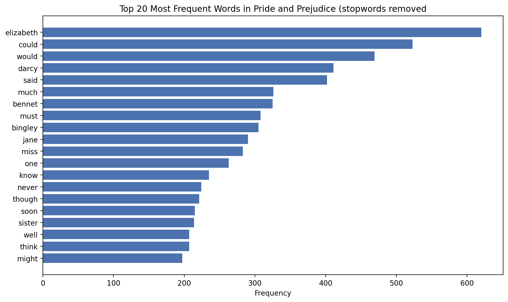
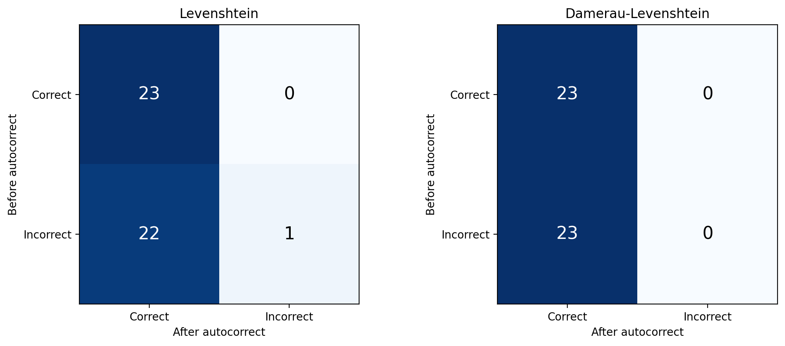

# Autocomplete and Autocorrect Data Analytics

Building and evaluating autocomplete and autocorrect from scratch in Python, using *Pride and Prejudice* as the text corpus.

**Oasis Infobyte Data Analytics Internship · Level 2, Task 5**

---

## Overview

This project looks at how well simple NLP techniques can predict the next word (autocomplete) and fix misspelled words (autocorrect). I built both features without any pre-trained models, measured them with precision and recall, compared two approaches for each, and discussed how they fall short of production systems like Google Keyboard.

## Key Results

| Feature | Method | Result |
|---|---|---|
| Autocomplete | Bigram model | Recall@3: **22.87%** · Precision@3: 7.78% |
| Autocomplete | Trigram model with bigram backoff | Recall@3: **20.59%** · Precision@3: 7.01% |
| Autocorrect | Levenshtein distance | **22/23** correct (95.65%) · 4.39s |
| Autocorrect | Damerau-Levenshtein distance | **23/23** correct (100%) · 6.87s |

## Main Findings

1. **Smarter edit distance fixed more words.** Damerau-Levenshtein counts a swap of two adjacent letters as one edit. It correctly fixed "recieve" to "receive", where standard Levenshtein picked "relieve". The cost was about 56% more run time.
2. **The simpler autocomplete model won.** The bigram model beat the trigram model on recall and precision. With only one book (about 96k training words), most three-word patterns appear once or twice, so the trigram model can't learn reliable statistics. A trigram model needs much more text to pay off.
3. **Autocomplete is a harder problem than autocorrect.** Predicting the exact next word in free text is much harder than correcting a misspelling, which is why autocomplete scores are far lower.
4. **Neither autocorrect method broke correct words.** All 23 correctly spelled test words were left unchanged by both algorithms.

## Methodology

1. **Corpus:** *Pride and Prejudice* from Project Gutenberg (eBook #1342), about 120,000 words after cleaning.
2. **Preprocessing:** tokenization, lowercasing, punctuation removal and stopword removal.
   - 145,477 raw tokens → 120,320 after punctuation removal → 52,761 after stopword removal
   - Two versions are kept: **with stopwords** for autocomplete, since words like "of the" help predict the next word, and **without stopwords** for word-frequency analysis
3. **Autocomplete:** frequency-based n-gram models (bigram and trigram with backoff) that return the top 3 predictions for a prefix. Tested on 10 prefixes and then evaluated on a held-out set.
4. **Autocorrect:** a custom edit-distance corrector using a dictionary built from the corpus (6,206 words). It picks the closest word within 2 edits and breaks ties by word frequency.
5. **Evaluation:**
   - *Autocomplete:* trained on the first 80% of the book, tested on the last 20% (24,062 test cases, 97.97% coverage). Metrics are top-1 accuracy, precision@3 and recall@3.
   - *Autocorrect:* 23 deliberately misspelled words covering missing letters, extra letters, swapped letters and wrong letters. Metrics are accuracy, precision and recall.
6. **Algorithm comparison:** bigram vs trigram, and Levenshtein vs Damerau-Levenshtein.
7. **Visualization:** top-20 most frequent words and confusion matrices for autocorrect (before and after).

## Sample Autocomplete Output

| Prefix | Prediction 1 | Prediction 2 | Prediction 3 |
|---|---|---|---|
| mr | darcy | collins | bennet |
| mrs | bennet | collins | wickham |
| i am | sure | not | afraid |
| my dear | lizzy | miss | aunt |
| you must | be | not | know |

## Visualizations








## Limitations

- **Small, single-domain corpus.** One 1813 novel, so the model doesn't know modern words and over-predicts character names.
- **Limited dictionary.** Autocorrect can only correct to words it has seen in the novel (about 6,200).
- **No sentence context.** It can't tell "their" from "there". Production systems rank candidates with a language model.
- **Small test set.** 23 hand-picked misspellings is not a full picture of real typing errors, which include phonetic mistakes and neighboring-key slips.
- **Basic tokenization.** Possessives split into stray tokens, for example "catherine" + "s".
- **Slow lookup.** Each word is compared against the whole dictionary. Production systems use indexed structures such as BK-trees.
- **Frequency-only prediction.** Production keyboards use neural language models and personalize to the user.

## Possible Improvements

- Use a much larger and more varied corpus
- Apply smoothing (Kneser-Ney or interpolation) to address trigram sparsity
- Rank autocorrect candidates using sentence context
- Add a keyboard-proximity error model
- Build a larger, more realistic test set

## Tech Stack

Python · pandas · NumPy · NLTK · Matplotlib · BeautifulSoup · Jupyter Notebook

## How to Run

```bash
# 1. Clone the repo
git clone https://github.com/<feith-i>/<Autocomplete&AutocorrectDataAnalysis>.git
cd <Autocomplete&AutocorrectDataAnalysis>

# 2. Install dependencies
pip install pandas numpy nltk matplotlib beautifulsoup4 jupyter

# 3. Launch the notebook
jupyter notebook "Autocomplete & Autocorrect.ipynb"
```

The first run downloads NLTK data (`punkt_tab` and `stopwords`), so an internet connection is needed once. Update the file path in the first cell to point to `pg1342-images.html` on your machine.

## Repository Structure

```
├── Autocomplete & Autocorrect.ipynb   # Full analysis notebook
├── pg1342-images.html                 # Pride and Prejudice (Project Gutenberg)
├── images/                            # Exported charts
└── README.md
```

## Data Source

*Pride and Prejudice* by Jane Austen, [Project Gutenberg eBook #1342](https://www.gutenberg.org/ebooks/1342). The text is in the public domain.

## Author

**Faith Aipoh** · Data Analyst
