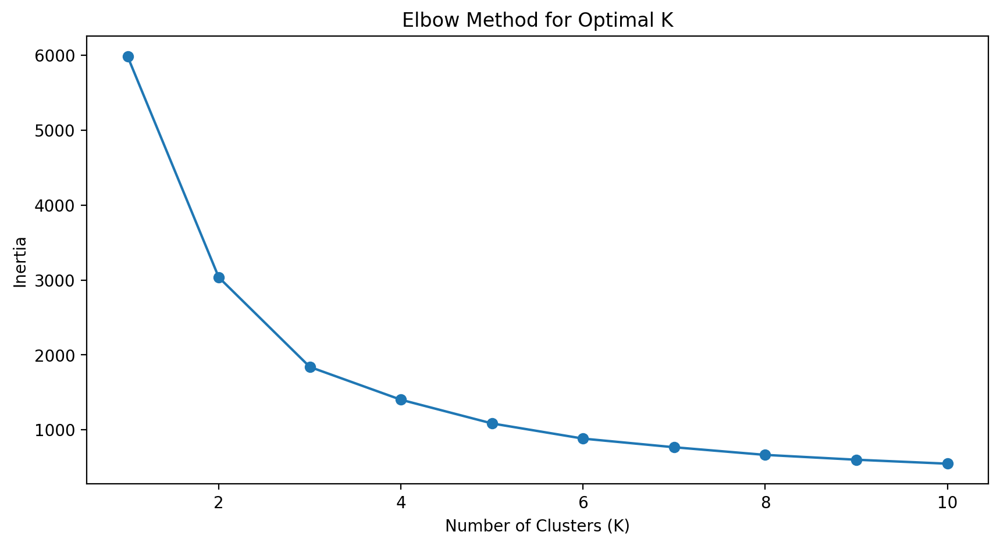
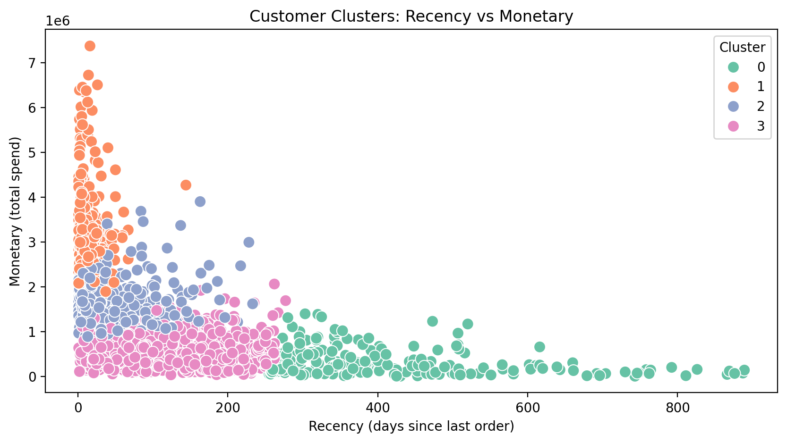
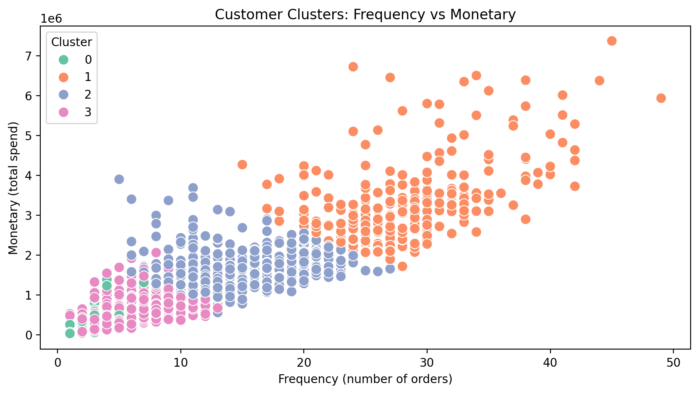
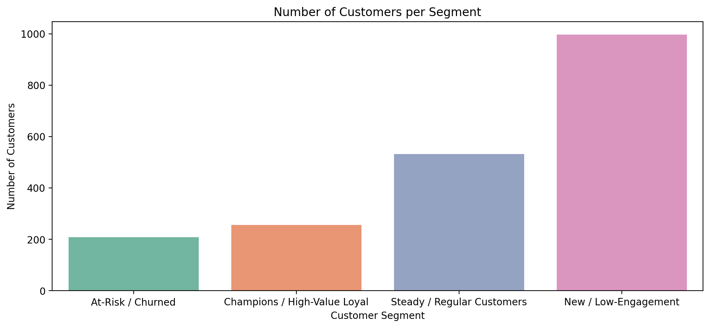

# Customer Segmentation Analysis (RFM + K-Means)

Segmenting an e-commerce customer base into distinct groups based on purchasing behavior, so the business can run targeted marketing strategies.

- **Project context:** Oasis Infobyte Data Analytics Internship, Level 1, Task 2

---

## Objective

Apply clustering algorithms to segment an e-commerce company's customers into distinct groups based on purchasing behavior, enabling targeted marketing strategies.

## Dataset

- **File:** `ecommerce_rfm_dataset.xlsx`
- **Size:** 22,000 orders × 20 columns
- **Unique customers:** 1,994
- **Key fields:** OrderID, CustomerID, CustomerName, Gender, AgeGroup, Region, Segment, PreferredChannel, SignupDate, ProductName, Category, OrderDate, Channel, Quantity, UnitPrice, GrossAmount, DiscountPct, DiscountAmount, NetAmount, PaymentMethod

## Tools & Libraries

- Python
- pandas, NumPy
- Matplotlib, Seaborn
- scikit-learn (`StandardScaler`, `KMeans`)
- Jupyter Notebook

## Methodology

### 1. Data Cleaning

| Issue | Finding | Fix |
|---|---|---|
| Missing customer names | 731 blanks + 270 `UNKNOWN` entries (1,001 total) | Converted `UNKNOWN` to missing, then filled with an ID-based label, e.g. `Customer 0566` |
| Inconsistent gender values | `M`, `male`, `Male`, `F`, `Female` | Standardized to `Male` and `Female` |
| Missing `DiscountPct` | 7,507 missing values, all with a discount amount of 0 | Filled with `0` (no discount applied) |

### 2. Feature Engineering (RFM)

Each customer was summarized with three metrics:

- **Recency:** days since the customer's last order, measured from one day after the latest order date in the dataset
- **Frequency:** number of orders placed
- **Monetary:** total spend (sum of `NetAmount`)

### 3. Scaling

Recency, Frequency, and Monetary sit on very different scales (days, single-digit counts, millions), so they were standardized with `StandardScaler` to stop Monetary from dominating the distance-based clustering.

### 4. Choosing the Number of Clusters

The elbow method was run for K = 1 to 10. Inertia drops sharply up to about 3 clusters and then flattens gradually. **K = 4** was chosen for segments that are distinct and actionable.

### 5. Clustering

K-Means (`random_state=42`, `n_init=10`) was fitted on the scaled RFM data, and each cluster was given a business-friendly label based on its average profile.

## Results

| Segment | Customers | Avg Recency (days) | Avg Frequency (orders) | Avg Monetary |
|---|---|---|---|---|
| Champions / High-Value Loyal | 256 | 14.95 | 28.55 | 3,368,656 |
| Steady / Regular Customers | 532 | 47.90 | 14.09 | 1,524,016 |
| New / Low-Engagement | 997 | 108.87 | 6.49 | 598,434 |
| At-Risk / Churned | 209 | 415.37 | 3.50 | 335,391 |

**Key observations**

- Frequency and Monetary show a near-linear relationship: customers who order more often spend more.
- The four clusters form clean, ordered bands along that relationship rather than random scatter.
- **Champions** are only about 13% of customers but account for roughly 37% of total revenue (estimated from segment averages multiplied by segment size).
- **New / Low-Engagement** is the largest segment, nearly half of the customer base.

## Charts 






## Insights & Recommendations

| Segment | Recommended action |
|---|---|
| **Champions** | Protect with a loyalty/VIP program: early access to new products, exclusive discounts, referral incentives. Focus on retention, not acquisition spend. |
| **Steady / Regular** | Upsell and cross-sell campaigns (bundles, "customers like you also bought") to nudge them toward Champion-level frequency. The most efficient segment for marketing spend. |
| **New / Low-Engagement** | Onboarding and nurture campaigns: welcome series, product education, second-purchase discounts. As the largest segment, even a small lift in purchase frequency has the biggest total revenue impact. |
| **At-Risk / Churned** | Win-back campaigns (reactivation offers, "we miss you" messaging) before these customers are lost for good. |


## How to Run

1. Clone the repository:
   ```bash
   git clone https://github.com/<your-username>/<your-repo-name>.git
   cd <your-repo-name>
   ```
2. Install the dependencies:
   ```bash
   pip install pandas numpy matplotlib seaborn scikit-learn openpyxl jupyter
   ```
3. Launch Jupyter and open the notebook:
   ```bash
   jupyter notebook
   ```
4. Run all cells in `Customer Segmentation Analysis.ipynb`.

## Author

**Faith Aipoh**
Data Analyst

- LinkedIn: https://linkedin.com/in/faithaipoh
- X (Twitter): https://x.com/feith_i

---

*Completed as part of the Oasis Infobyte Data Analytics Internship.*

