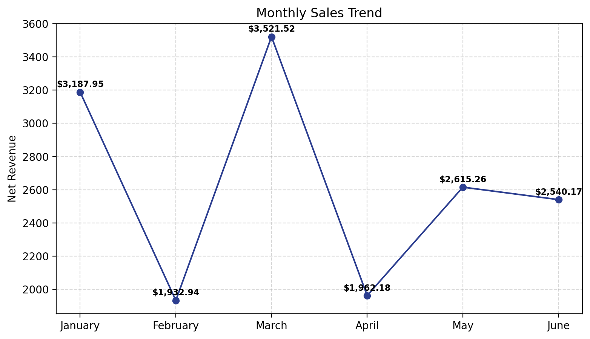
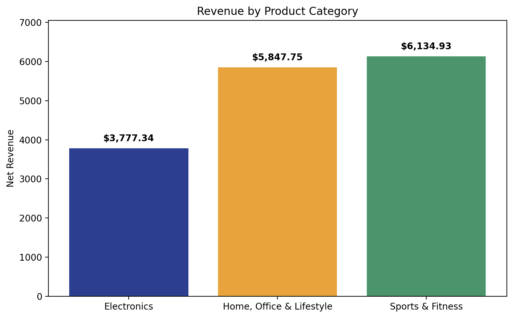
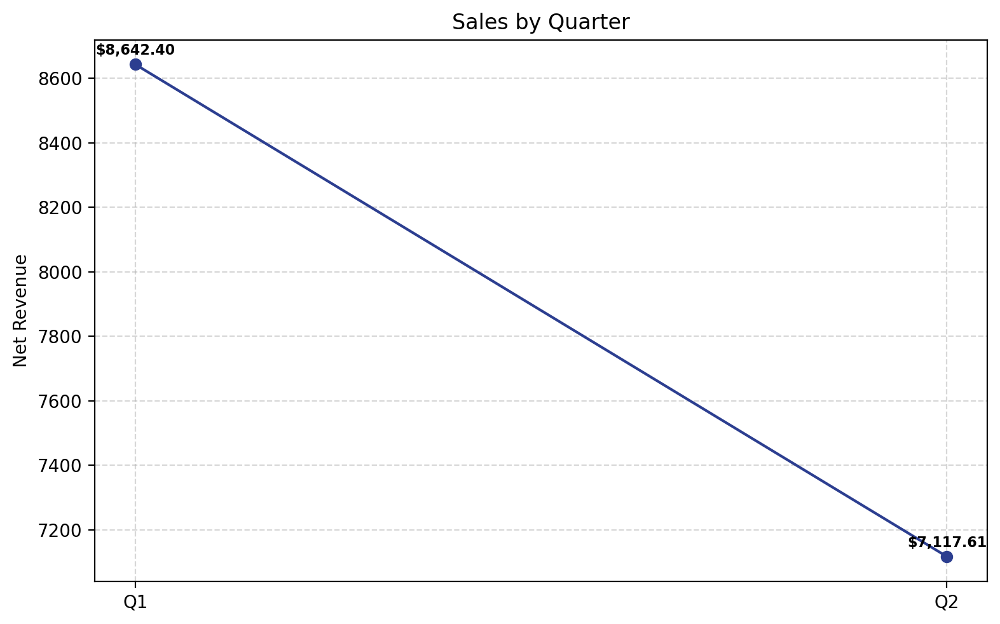
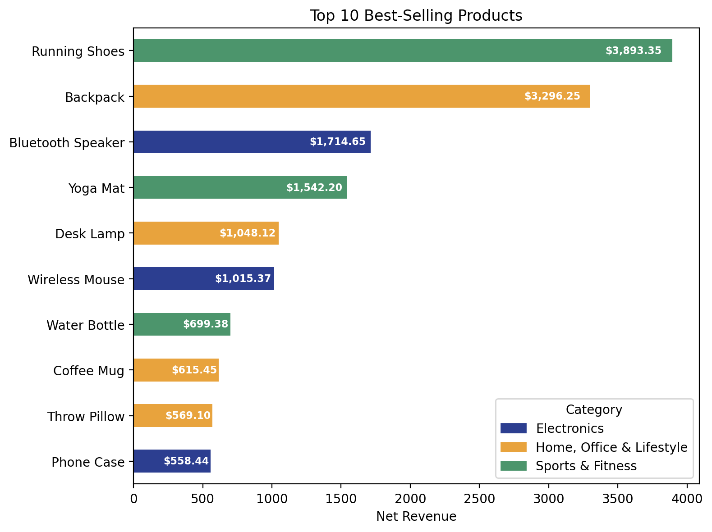

# Task 1: EDA on Retail Sales Data

**Intern:** Faith Aipoh| **Track:** EDA on Retail Sales Data| **Level:** 1

## Objective
Explore retail sales data to uncover revenue trends, top products and categories, and the effect of discounts, then turn the findings into business recommendations.

## Tools
Python, pandas, matplotlib, seaborn, Jupyter Notebook

## Key Findings
- **Discounts don't drive bigger orders.** Discount amount has almost no correlation with net revenue, and the highest-revenue order had a 0% discount.
- **A few products carry the revenue.** Running Shoes and Backpacks generate nearly as much revenue as the bottom eight products combined.
- **Category gap.** Sports & Fitness and Home, Office & Lifestyle significantly outperform Electronics.
- **March spike.** March nearly doubled the revenue of other months, and Q2 revenue fell 17.6% from Q1 because it had no comparable standout month.

## Recommendations
1. **Reassess the discount strategy.** Test reducing or removing discounts on select products to recover margin.
2. **Double down on top performers.** Prioritize marketing and inventory for top products and categories, and consider bundling low performers like Phone Case and Throw Pillow.
3. **Investigate the March spike.** Find the cause (promotion, seasonality, bulk order) and test replicating it.

## Key Visualizations

## Demo Video
[Watch the walkthrough](PASTE-LINK-HERE)

## Files
- `EDA_on_Retail_Sales_Data.ipynb`: full analysis
- `data/ecommerce_sales_raw.csv`: raw dataset
- `images/`: chart exports
