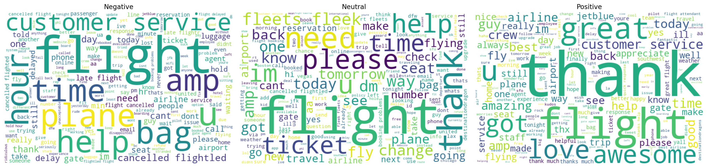
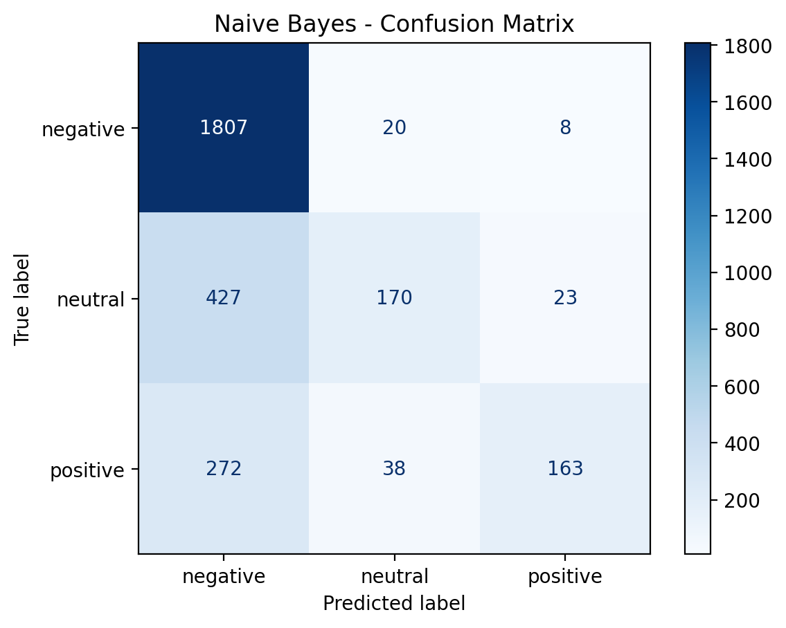
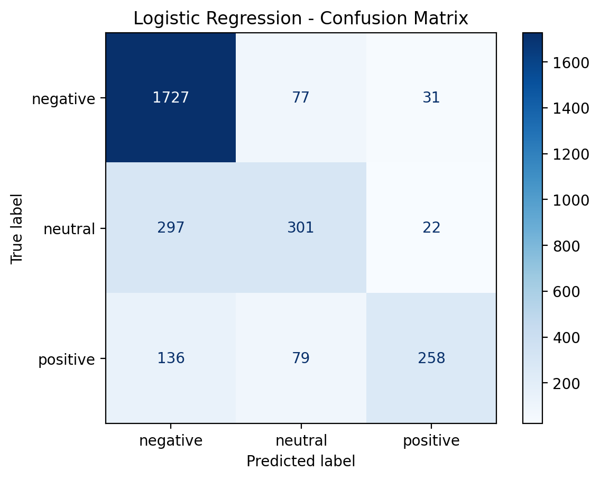
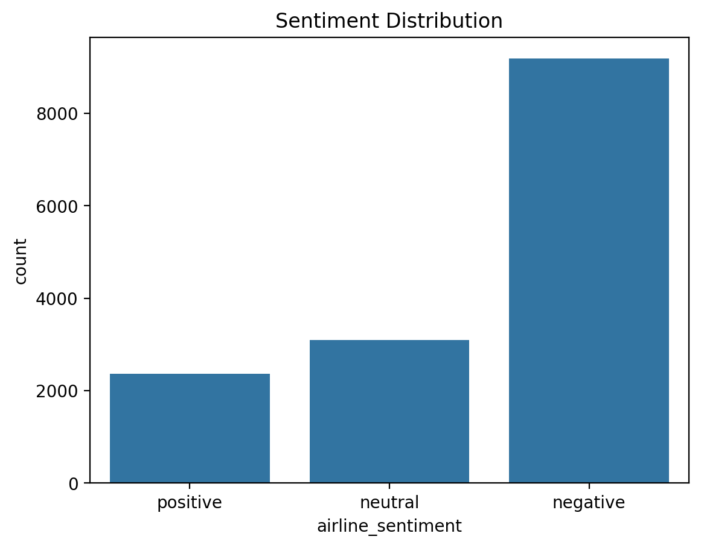

# Task 4: Sentiment Analysis

**Track:** Data Analytics
**Name:** Faith Aipoh
**Level:** 1
**Internship:** [Oasis Infobyte](https://oasisinfobyte.com) — Data Analytics Internship Program

This project was completed as part of the Oasis Infobyte Data Analytics Internship, where I worked through a series of hands-on tasks covering EDA, dashboarding, and machine learning to build practical, portfolio-ready data analytics skills.

## 📌 Objective
Build a machine learning model that classifies the sentiment of text data (positive, negative, or neutral), providing insights into public opinion or customer feedback.

## 🛠️ Tech Stack
- Python
- pandas
- scikit-learn
- NLTK
- matplotlib / seaborn
- WordCloud
- Jupyter Notebook

## 📂 Dataset
Twitter US Airline Sentiment dataset — ~14,640 tweets directed at major US airlines, each labeled as **positive**, **neutral**, or **negative**.

## 🔍 Project Workflow

1. **Exploratory Data Analysis** — Inspected class distribution across sentiment labels.
2. **Text Preprocessing** — Lowercased text, removed @mentions, URLs, punctuation, numbers, and stopwords.
3. **Feature Extraction** — Converted cleaned text into numeric features using TF-IDF Vectorization (5,000 features).
4. **Train/Test Split** — 80/20 stratified split to preserve class proportions.
5. **Model Training** — Trained two classifiers: Naive Bayes and Logistic Regression.
6. **Evaluation** — Compared models using accuracy, precision, recall, F1-score, and confusion matrices.
7. **Visualization** — Generated word clouds for each sentiment class to surface common language patterns.
8. **Error Analysis** — Reviewed misclassified tweets to identify model limitations (sarcasm, short tweets, mention-heavy posts).

## 📊 Key Results

| Metric | Naive Bayes | Logistic Regression |
|---|---|---|
| Accuracy | 73% | **78%** |
| Neutral Recall | 27% | **49%** |
| Positive Recall | 34% | **55%** |

**Logistic Regression outperformed Naive Bayes** across all metrics, handling the class imbalance (63% negative tweets) far better than Naive Bayes, which was heavily biased toward predicting "negative."

## 🧠 Key Insight
The dataset is strongly imbalanced toward negative sentiment, which can inflate apparent accuracy while masking poor performance on minority classes. Error analysis revealed the model struggles most with sarcasm, very short tweets, and posts dominated by @mentions or hashtags rather than sentiment-bearing words.

## 💡 Real-World Application
This type of model could power an airline customer service triage system — automatically flagging negative tweets for urgent response, routing neutral inquiries to general support, and surfacing positive feedback for marketing or employee recognition.

## Charts

## 🎥 Demo Video
[Link to walkthrough video](#)

## 📁 Repository Structure

    ├── data/
    │   └── Tweets.csv
    ├── images/
    │   ├── word_cloud.png
    │   ├── Naive_Bayes_matrix.png
    │   ├── Logistic_Regression_matrix.png
    │   └── sentiment_distribution.png
    ├── Sentiment_Analysis.ipynb
    └── README.md
