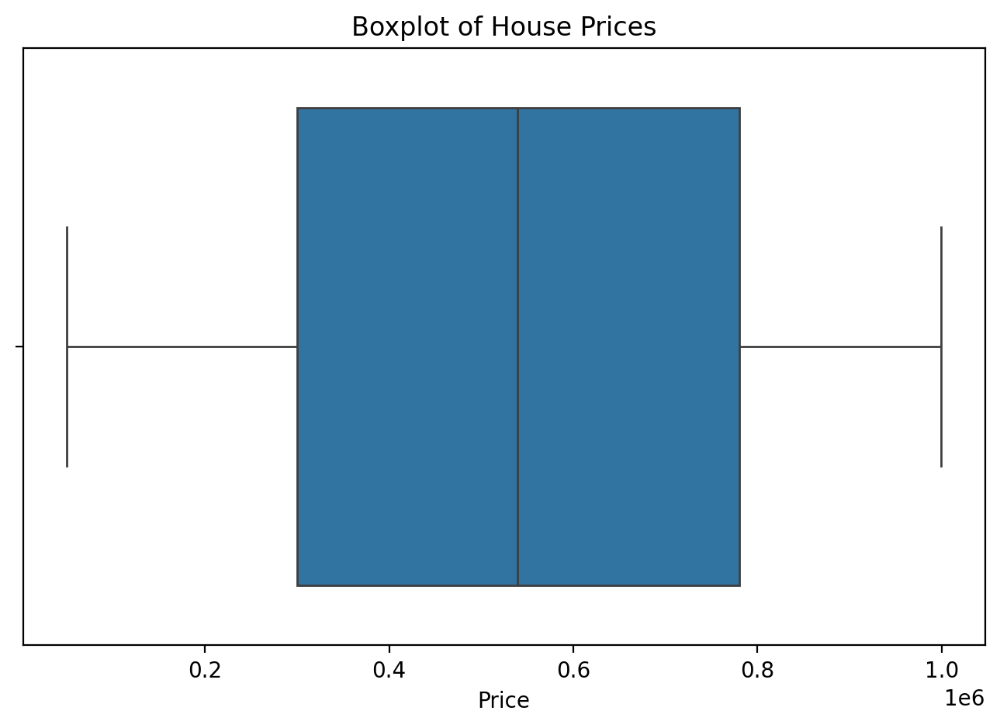
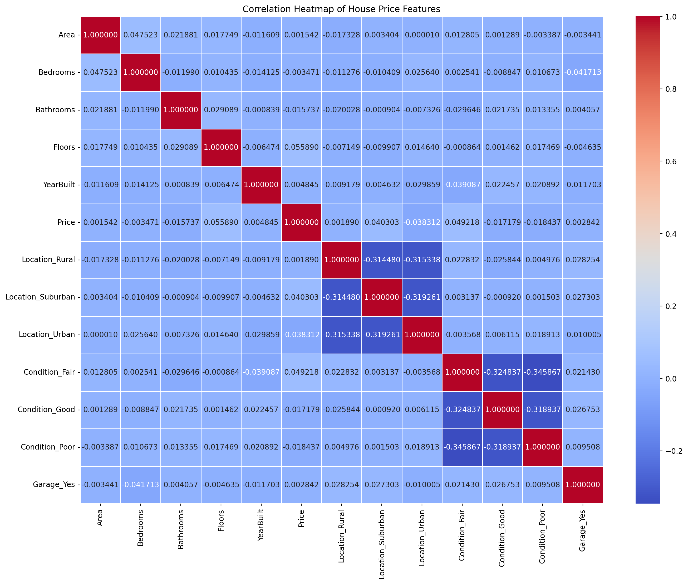
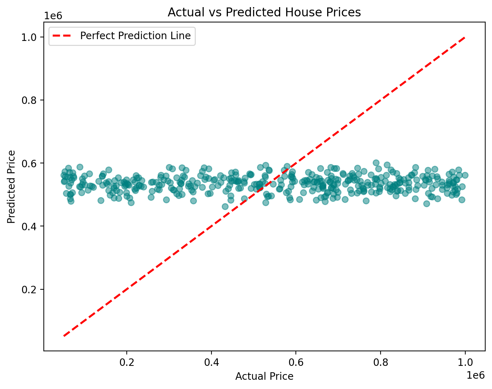
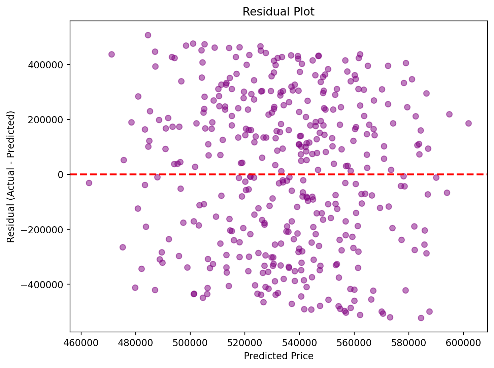

# Predicting House Prices with Linear Regression

## 📌 Project Overview
This project builds and evaluates a **Linear Regression model** to predict house prices based on features such as area, location, number of rooms, and age. It was completed as part of the **Oasis Infobyte Data Analytics Internship (Level 2, Task 1)**.

The goal was to develop end-to-end machine learning skills — from data cleaning and exploratory data analysis (EDA) through model training, evaluation, and interpretation.

## 🛠️ Tech Stack
- Python
- pandas
- scikit-learn
- matplotlib
- seaborn
- Jupyter Notebook

## 📂 Data
- `House Price Prediction Dataset.csv`

Features: `Id`, `Area`, `Bedrooms`, `Bathrooms`, `Floors`, `YearBuilt`, `Location`, `Condition`, `Garage`, `Price`

## 🔍 Workflow
1. **Exploratory Data Analysis (EDA)**
   - Null value check (no missing values found)
   - Descriptive statistics
   - Distribution of `Price` (histogram, boxplot, skewness)
2. **Feature Selection Discussion**
   - Hypothesized `Area`, `Location`, and `Bedrooms` as likely strong predictors
3. **Data Preprocessing**
   - One-Hot Encoding of categorical features (`Location`, `Condition`, `Garage`)
   - Dropped non-predictive `Id` column
4. **Correlation Analysis**
   - Heatmap and sorted correlation list against `Price`
5. **Train/Test Split**
   - 80/20 split using `train_test_split`
6. **Model Training**
   - Linear Regression via scikit-learn
7. **Model Evaluation**
   - MSE, RMSE, R² score
   - Actual vs. Predicted scatter plot
   - Residual plot
8. **Coefficient Analysis**
   - Reviewed each feature's impact on predicted price
9. **Bonus: Regularization Comparison**
   - Compared Linear Regression against Ridge and Lasso regression

## 🖼️ Images
| Boxplot of House Prices | Correlation Heatmap |
|---|---|
| 

 | 

 |

| Actual vs. Predicted | Residual Plot |
|---|---|
| 

 | 

 |

## 📊 Key Findings
- **No feature showed a meaningful correlation with `Price`** — the strongest correlation was only ~0.05, far below the ~0.3 threshold typically considered meaningful.
- The model's **R² score was slightly negative (-0.0067)**, meaning it performed no better than simply predicting the average price for every house.
- The **Area coefficient was -0.58**, suggesting larger houses were predicted to be marginally *cheaper* — the opposite of real-world housing behavior.
- **Ridge and Lasso regression produced nearly identical results** to plain Linear Regression, confirming the issue was a lack of genuine signal in the data rather than overfitting.
- This strongly suggests the dataset's `Price` values were **synthetically/randomly generated**, independent of the other features.

## 💡 Takeaway
While the model did not achieve strong predictive performance, this project demonstrates the ability to **diagnose and clearly communicate why a model underperforms** — using correlation analysis, residual diagnostics, coefficient interpretation, and regularization comparisons — rather than treating a low R² as a dead end.

## 📁 Files
- `Predicting House Prices.ipynb` — Full analysis notebook
- `House Price Prediction Dataset.csv` — Dataset used

## 🎥 Demo
[Watch the Video](https://drive.google.com/file/d/1MD6MQ18wjYsJzR_ddCVbcU7R4bWS_LDC/view?usp=drivesdk)

## 👤 Author
**Faith Aipoh** — Data Analyst 
