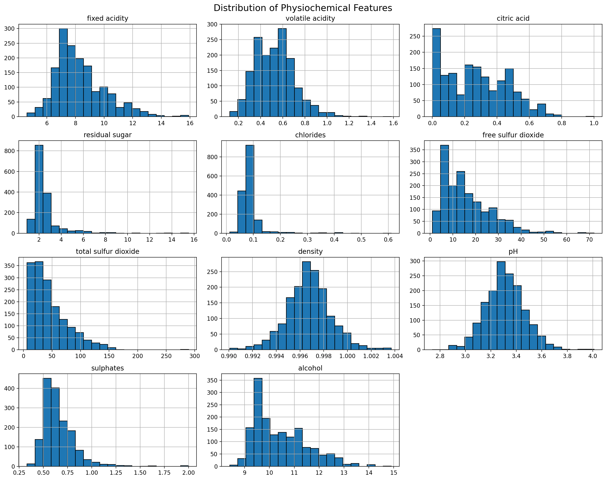
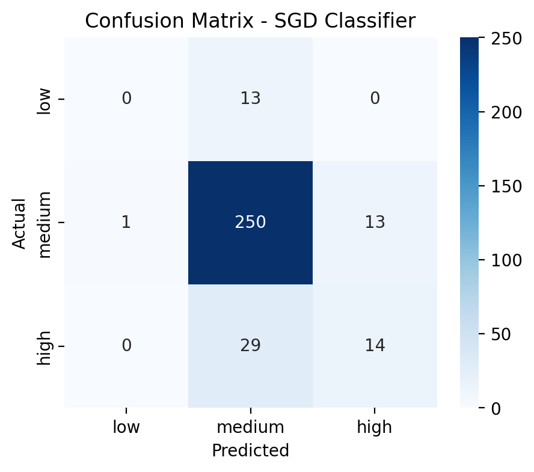
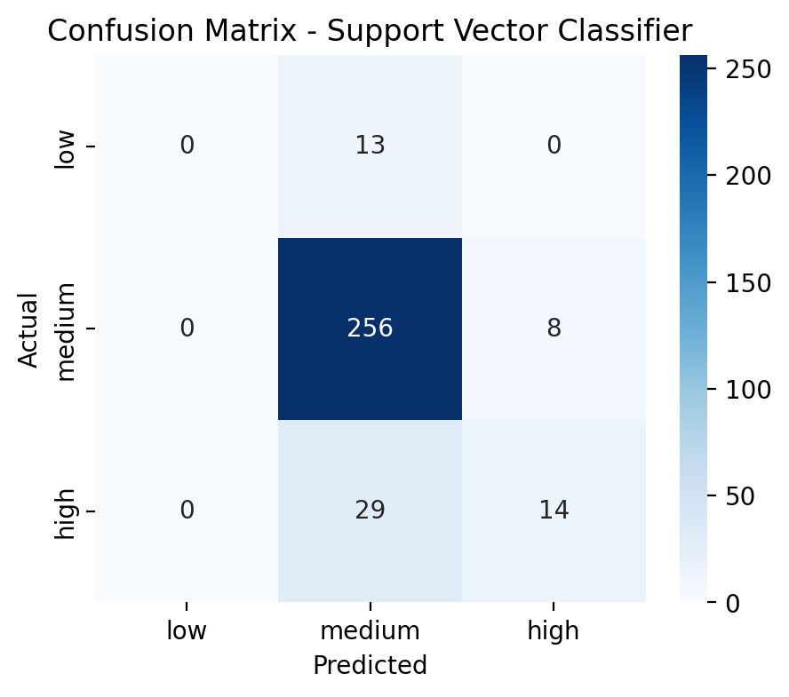

# Wine Quality Prediction

**Name:** Faith Aipoh
**Track:** Data Analytics
**Level:** 2
**Task:** 3

## Objective
Train and compare multiple classification models to predict the quality of wine (originally scored 3–8) based on its physicochemical properties — acidity, density, alcohol content, and more.

## Tech Stack
- Python
- pandas, numpy
- scikit-learn (Random Forest, SGD Classifier, SVC)
- seaborn, matplotlib
- Jupyter Notebook

## Dataset
UCI Wine Quality dataset — 1,599 samples, 11 physicochemical features, and a `quality` score (3–8).

## Workflow

1. **Data Loading & Inspection**
   Loaded the dataset and checked its structure, confirming no missing values. Found the `quality` distribution heavily imbalanced — over 82% of samples scored 5 or 6, with very few at the extremes (3, 4, 8).

2. **Exploratory Data Analysis**
   - Plotted distributions for all 11 chemical features — most were right-skewed with outliers (e.g. residual sugar, chlorides), while density and pH were close to normally distributed.
   - Built a correlation heatmap. **Alcohol** showed the strongest positive correlation with quality (0.48); **volatile acidity** showed the strongest negative correlation (-0.39).

3. **Handling Class Imbalance**
   Binned the original 6-class quality score into 3 broader categories — **low** (3–4), **medium** (5–6), **high** (7–8) — to give each class enough samples to be learnable, while preserving meaningful quality distinctions.

4. **Train/Test Split**
   Used an 80/20 **stratified** split to preserve the low/medium/high ratio in both sets, since "low" made up only ~4% of the data.

5. **Model Training**
   Trained three classifiers:
   - **Random Forest** (unscaled features)
   - **SGD Classifier** (scaled features)
   - **Support Vector Classifier** (scaled features)

6. **Evaluation**
   Evaluated each model with accuracy, a full classification report (precision/recall/F1 per class), and a confusion matrix.

   | Model | Accuracy | Recall (Low) | Recall (Medium) | Recall (High) |
   |---|---|---|---|---|
   | Random Forest | 0.8656 | 0.00 | 0.97 | 0.51 |
   | SGD Classifier | 0.8250 | 0.00 | 0.95 | 0.33 |
   | SVC | 0.8438 | 0.00 | 0.97 | 0.33 |

7. **Feature Importance**
   Extracted feature importances from the Random Forest model. Results closely matched the correlation heatmap — **alcohol** and **volatile acidity** were the top two most influential features.

## Conclusion
**Random Forest** is the most suitable model for deployment — it achieved the highest accuracy and the best recall on the "high" quality class, requires no feature scaling, and produces interpretable feature importance scores.

**Key limitation:** none of the three models could correctly identify any "low" quality wines, due to severe class imbalance (only 63 of 1,599 samples). Before real-world deployment, this would need to be addressed with techniques such as SMOTE oversampling, class-weighting, or collecting more low-quality samples.

## Data
- `winequality-red.csv` — UCI Wine Quality dataset (red wine), 1,599 samples, 11 physicochemical features plus `quality` score

## Images
 — distribution plots for all 11 chemical features
 — confusion matrix for the Random Forest model
 — confusion matrix for the SGD Classifier model
 — confusion matrix for the Support Vector Classifier model

## Files
- `wine_quality_prediction.ipynb` — full notebook with EDA, modeling, evaluation, and conclusions
- Demo video: *(link here)*
